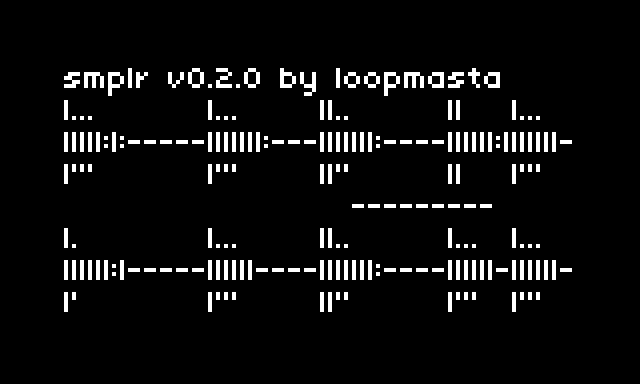

# smplr

record a stereo take and play it back with up to six playheads.



smplr records the stereo input into softcut and plays it back with up to six heads. each head has its own loop, pitch, volume, pan, direction, highpass filter and modulator. the take's transients are found automatically, so loops can jump from hit to hit. hold K2 while playing to punch new material in at the selected head. the take and all settings are saved automatically and come back at the next start.

## requirements

- norns or a norns clone (tested on a shieldXL, Raspberry Pi 4, norns 2.9.4)
- stereo audio input

## documentation

### controls

| control | action |
|---|---|
| E1 | select head (top to bottom, as on screen) |
| K1 + E1 | edit mode: LOOP, SOUND, MOD, VIEW |
| K2 (stopped) | start / stop recording |
| K2 (stopped, hold 1 s) | empty take of `max length`, to punch into |
| K2 (playing, hold) | punch in at the selected head |
| K3 | play / stop |
| K1 + K2 | randomize (depends on the edit mode) |
| K1 + K3 | toggle (depends on the edit mode) |
| K1 + K3 (LOOP, hold ½ s) | loop edit: resize / move |

### edit modes

| mode | E2 | E3 | K1 + K2 | K1 + K3 |
|---|---|---|---|---|
| LOOP | loop start (move: move loop) | loop end (move: move loop) | random loop | free / transient |
| SOUND | pick: pitch, volume, pan, mode, hpf | change | random sound | reverse / forward / muted |
| MOD | pick: target, shape, speed, amount | change | random modulator | target: off / head / loop |
| VIEW | zoom | scroll | zoom to the selected loop | zoom off / on |

hold K1 to see the current mode.

in LOOP, holding K1 + K3 for half a second switches the loop edit between **resize** (E2 moves the loop's start, E3 its end) and **move** (E2 and E3 both move the whole loop; its length stays).

### transients

after every new take and every punch-in, smplr finds the take's transients (SuperCollider's `Onsets`, in the background; a few seconds at most). K1 + K3 in LOOP switches the loop points between **free** (fine steps, as always) and **transient**: the transients show as ticks on the waveform (in every mode, so also while zooming in VIEW), and E2 / E3 jump the loop's start and end between them and the take's start and end. in move, E2 / E3 move the whole loop one transient at a time; K1 + K2 picks a random loop of 1–8 slices. `sensitivity` sets how many are found: higher finds softer attacks too. each transient sits a few milliseconds before its attack, so a loop starting there doesn't cut it off.

demo video with transient detection (screen and sound straight from the norns): [youtube.com/watch?v=A0jXmPob0JA](https://www.youtube.com/watch?v=A0jXmPob0JA)

### heads

softcut has six voices. a head's `source` is `left` or `right` (one voice, plays buffer 1 or 2) or `both` (two voices, plays the stereo take). so six heads fit as 6 mono, 1 stereo + 4 mono, 2 stereo + 2 mono or 3 stereo. a new recording resets every head: only H1 is on, a stereo head over the whole take. turn on more heads in PARAMS > HEAD 2–6 > source.

on screen, stereo heads' loop bars sit above both waveforms, mono heads' bars below their buffer's waveform. the selected head's bar is bright.

### modulator

each head has a modulator (sine, saw, triangle or random, 0.01–10 Hz):

- **loop**: moves the whole loop window back and forth
- **head**: makes the playhead jump around inside the loop

### params

- **SMPLR**: `max length` (1–300 s, default 20 s), `loop length` (info), `loop edit` (resize / move), `loop points` (free / transient), `sensitivity` (0–100 %, default 40 %: how many transients are found; changing it analyses the take again)
- **HEAD 1–6**: source, start, end, mode, pitch (±24 semitones), volume, pan, hpf (off, 20 Hz – 4 kHz), mod target, shape, speed, amount

### files

- `dust/audio/smplr/loop.wav`: the take
- `dust/data/smplr/take.lua`: the take's length and transients
- `dust/data/smplr/last.pset`: the params, written on exit

## install

```
;install https://github.com/loopmasta/smplr
```

or copy `smplr.lua` and `lib/` to `dust/code/smplr/`.

smplr brings a small SuperCollider engine (`lib/Engine_Smplr.sc`) for the transient analysis. after installing or updating, **restart norns once** (SYSTEM > RESTART), so SuperCollider picks it up.
